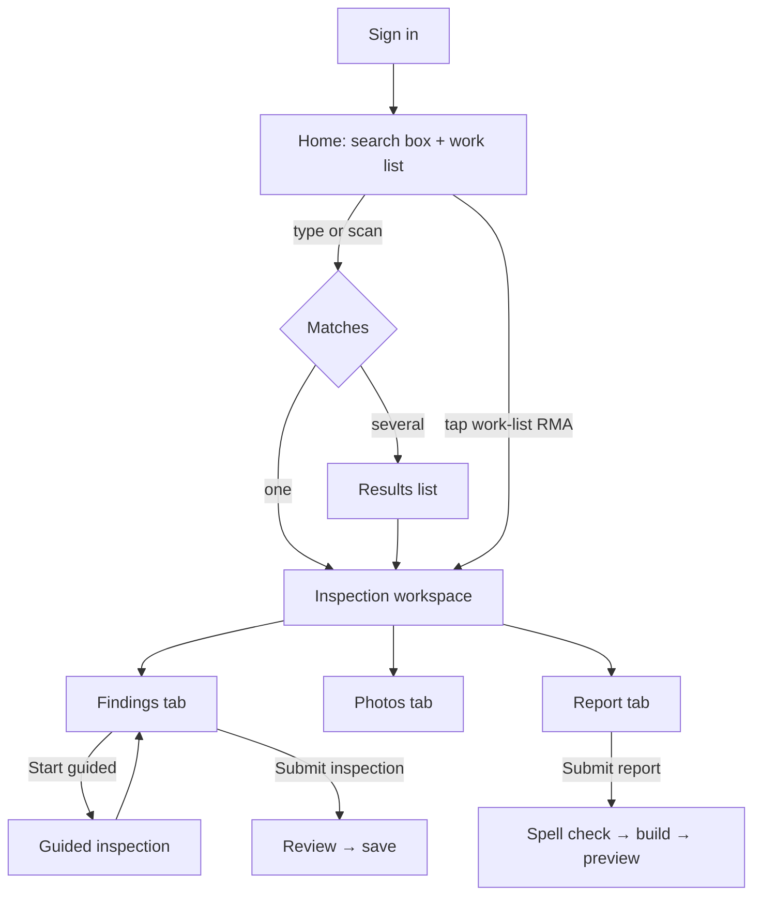

# RMA Inspection App — Functional Spec (v1 DRAFT)

_Rev 7 — 2026-11-18 (Jacob's layout decisions: sign-in, camera search, Received-only work list with product-type
and return-code chips, inspection workspace with Findings / Photos / Report tabs, guided inspection, status rules
on submit, Report tab). Layout/behaviour spec — built in later issues. Rev 6 (2026-11-17): SAP-ready contract.
Source-of-truth order: `RMA_DATA_MAP.md` > context pack 00–04 > Macola_SQL_Context. API: `docs/api.md` (rev 7);
decisions: `docs/decisions.md`._

> All RMA numbers, names and folder paths in this file are **fake examples**. No real RMA/customer data,
> server names, IPs or credentials belong in this repo.

---

## 1. Purpose and scope

- **The inspector does the whole inspection and the report in the app.** Report writing follows straight after the
  inspection, in the same workspace. Changes to the Windows workbench come later; until then it keeps working on the
  same data.
- **All sign-ins have all functions in v1**; roles come later.
- Tablet target: **11" or larger**, landscape first; portrait works. Phones work for previewing progress.
- Not in the app: close / reopen RMAs and the RMA-team fields (credit status, failure code, failure description,
  comments — shown read-only).
- Scroll: listed, but read-only ("Handled in the repair database"); scroll capability is off in v1.
- AI features: later phase.

---

## 2. Sign-in

- **First screen:** username + password, checked by the server (`POST /auth/login` → token). Replaces the
  inspector picker.
- v1 credentials are a **server setting** (mock: a fake demo user). No credentials in the app or the repo.
- **Stays signed in until the user signs out** (Settings → Sign out). Sign-out clears the **session and the screen
  history only — never the upload queue**. Only the token is stored (encrypted with an Android Keystore key) —
  **never the password**.
- **A `401` mid-session** shows sign-in on top of the current screen; after signing in again the user returns to
  the **same screen and RMA** (fallback: Home). Back on that sign-in screen leaves the app.
- **Queued uploads belong to the inspector who made them.** While that inspector is signed out they are **held** on
  the tablet until the **same** inspector signs in again. They are never sent under another user's token and never
  re-attributed.
- **Sign out with waiting uploads:** "You have N uploads waiting. Send now before signing out?" — **Send now**
  (uploads first with progress, then signs out; if offline, says so and offers **Sign out anyway**) ·
  **Sign out anyway** (uploads stay held).
- **Sign in with held uploads:** "N uploads waiting from your earlier session" — sent automatically.
- The signed-in user's initials pre-fill Inspected by / Summary by. Their name is shown in Settings.
- Sign-in screen also shows server reachability and the app version, and links to Settings (server address).

---

## 3. Find an RMA (Home)



### 3.1 Search box
- **One search box** for RMA number, serial or (after SAP) SAP number — the server decides what it matches.
- **Camera icon** in the box: on-device **ML Kit** barcode / QR scanning, plus **text recognition** for serial
  plates. The result fills the box and runs the search. Nothing leaves the tablet except the search text.
- One match → open it. Several → results list (same card as the work list). None → "No RMA found for …".

### 3.2 RMA cards (results and work list)
Each card shows: **RMA** (display number), **model**, **product type**, **return code**, **age** ("23 days" from
`status_since`, with "estimated" when `status_since_estimated`), **status**, and badges: **core teardown**, **lock**
(open elsewhere), **read only** (scroll / closed), and **"Return code / status changed"** for draft RMAs that no
longer match the filters (§3.3).

### 3.3 Work list (below the search box)
- Shows **only inspection status Received** (`work_list_statuses`, server setting).
- **Filter chips** for **product type** and **return code**; the tablet remembers the last selection.
  - Defaults (server settings): product types **Recip, Scroll, Screw, Part**; return codes **Inspection Only,
    Repair & Return, Warranty**. The chips offer every product type and return code the server lists.
  - Matching is trimmed / uppercase on the server, so the SAP rollout can change values without an app update.
- **Sort:** oldest `status_since` first, then RMA number.
- Open = the Trend Tracker's rule (combined Macola header view `status='O'` joined to the inspection record).
- **RMAs with a draft on this tablet stay on its list** even if they no longer match (return code or status
  changed), with a **"Return code / status changed"** badge — work in progress never disappears.
- Scroll RMAs appear but open read-only with the "Handled in the repair database" banner.
- Pull down to refresh; count shown above the list.

---

## 4. Inspection workspace

Opening any RMA goes straight to its workspace (there is no separate overview screen).

### 4.1 Persistent header (all tabs)
RMA, model, product type, return code, status, customer, serial — plus an **expandable failure info** panel
(failure code, failure description, comments; read-only). Lock / read-only / changed-elsewhere banners sit under
the header. The **guided inspection button** is in the header (§5).

### 4.2 Tabs
**Findings · Photos · Report.**
- **Landscape: two panes** — list on the left, detail on the right.
- **Portrait:** list → tap → detail (back returns to the list).

### 4.3 Findings tab
- Parts list in the inspector's order: `NN  part code  part description · issue code  issue description · 📷 n · 📝`.
  Existing rows load first in server order; each keeps its opaque `row_id`.
- **"Add part" is always visible** (floating button / pinned at the bottom of the list).
- **Part detail opens as a sheet over Findings**: part (searchable picker), issue (searchable dropdown, `50` Normal
  first), cause (only when the server sends causes), note (≤ 4000, counter), photos for this row.
- Reorder (drag), delete (with undo), full control over desk-entered rows.
- Pickers: search by code or description; natural sort; codes are code objects sent back exactly as received;
  "recently used" strip.
- **Manual entry has no requirements** (required items exist only in guided mode).
- **Local draft:** every change is saved at once to a draft on the tablet (one per inspector and RMA, with the
  RMA's `signature` as `base_signature`); it survives an app kill. Existing rows keep their `row_id`, new rows have
  `row_id: null`. The draft is removed when the rows match the server again (and after a successful submit, §6.4).
- Button: **Submit inspection** (§6).

### 4.4 Photos tab
- All photos for the RMA (thumbnails from the server so desk photos show too), grouped by part, plus RMA-level
  photos (As received, Nameplate, Overview, Packaging/Freight, Other + text).
- Take / retake / delete; filename preview per §9. Photos are optional in manual mode.
- Button: **Submit inspection** (§6).

### 4.5 Report tab
See §7.

---

## 5. Guided inspection

- **Header button** shows: **Start** · **Continue (step x of y)** · **Complete** · disabled **"No guided list for
  <product type> yet"**. **v1 ships with no checklists**, so the button is disabled for every type until the server
  sends one.
- Checklists are **server-served** in `/codelists` → `checklists`, keyed by product type: a list of steps, each a
  part code plus photo rules (api §4). Changing a checklist needs no app update.
- Planned photo grid: required part + `50` Normal → **overall** photo required; non-normal → **overall + detail**
  required.
- **Each step:** part code (fixed by the step), issue code as a **searchable, scrollable dropdown defaulting to
  `50` Normal** (no chip grid), optional note, **photo slots with Required / Optional badges**.
  - **Skip** is disabled while a step has required photos missing; **Next** is disabled until required items are done.
  - Steps write straight into Findings (same rows as manual entry). **Resumable** — leave and continue later.
    Existing rows for that part are pre-filled.
- **Finish** → "Inspection complete" dialog → back to the workspace.
- Required items apply only in guided mode.

---

## 6. Submitting

### 6.1 Submit inspection (Findings / Photos tabs)
A **review screen** comes first: rows added / changed / removed, photos to upload, the status that will be set.
Then, by the RMA's current status (`status_roles` from the server):

| Current status | What happens |
|---|---|
| Before **Inspected** (e.g. Received, Rework in Progress) | Save findings + photos, set status **Inspected**. |
| **Report Complete** | Dialog "Report already complete" → **Update inspection findings**: save, keep the status, rebuild the report. |
| **Sent to RSM** / **Issued to Customer** | Same, with warning: "This report was already sent. Updating will regenerate it; you may need to resend it." |
| Inspected / other | Save, keep the status. |

### 6.2 Submit report (Report tab)
1. **Automatic spell check** on the summary (and notes): flagged words with suggestions — **Fix**, **Ignore**,
   **Add to dictionary** (shared, server-side).
2. **Build** PDF + XLSX → **preview**.
3. **First build sets Report Complete**; afterwards it only regenerates. Past Report Complete, the same warnings as
   §6.1 apply (report already sent → may need to resend).
4. Unsent findings must be saved first (the app does it as part of Submit report).

### 6.3 What a submit sends

1. **Findings**: `POST /rmas/{rma_id}/inspection` with the full desired parts list (existing rows by `row_id`,
   new rows with `row_id: null`), optional status change, optional summary (defect code, changed summary blocks,
   `inspected_by`, `summary_by` — only changed parts), `base_signature` and `submission_id`. The response
   returns new `row_id`s, which replace the old ones on the tablet. Macola server runs the `apply_flex` path: validate → Macola lock check
   (fail closed) → re-read with UPDLOCK + signature compare → JSONL backup → status → summary row
   (UPDATE by `rec_id`, or INSERT with the raw padded `cus_no`) → parts → renumber `line_no` → commit → verify.
   A status change also writes one `OERMAAUD_iPro` row with the inspector's identity. Parts, defect code and
   summary edits write no audit row (matches Macola).
   The summary-row INSERT path is untested against production — include it in the Phase 4 read-only dry run
   and the first supervised writes.
2. **Photos**: `POST /rmas/{rma_id}/photos`, one per photo, after step 1 succeeds (so `SS` matches the saved row
   order). If step 1 is blocked, the inspector may choose **Send photos only** (names use the tablet's order).
3. The tablet shows final filenames returned by the server.

---


### 6.4 Save results (any submit)
| Result | Tablet shows | What happens to the draft |
|---|---|---|
| Saved (`200`) | "Saved ✓" + photo upload progress | Draft cleared once photos finish; new signature stored |
| Offline / server unreachable | "Queued — will send when online" | Kept in queue, auto-retry with back-off |
| **RMA changed** (`409 RMA_CHANGED`) | Conflict screen (§6.5) | Kept; nothing written |
| **Locked in Macola** (`423 RMA_LOCKED`) | "Open in Macola by <name> since… — will retry" (or "Possible stale lock — ask IT") | Kept; auto-retry every few minutes; inspector can cancel |
| Lock check failed (`503 LOCK_CHECK_FAILED`) | "Can't confirm Macola lock — nothing saved, will retry" | Kept; auto-retry |
| Validation (`422`) | Field-level errors (unknown code, too long, bad transition) | Kept; inspector fixes |
| RMA closed / not inspectable (`409 RMA_NOT_OPEN`) | "RMA is closed — ask the RMA team" | Kept read-only; can export/discard |
| Product type not enabled (`403`) | Read-only banner | Kept read-only |

The tablet **never** silently overwrites and never retries a `409 RMA_CHANGED` on its own.

### 6.5 Conflict screen
- **Rule: any change made elsewhere while the inspection is in progress is reviewed, never overwritten.** The
  server's change check covers the **whole RMA record** it loaded — including fields the tablet can't edit
  (Comments, Failure Code/Description, credit status) — and `Report Pics `.
- Shows everything that changed on the server since the tablet downloaded the RMA (status, rows, defect code,
  summaries, initials, RMA-team fields) next to the local edits. Common case: summary typed at the desk while
  the tablet had a draft. Changes to RMA-team fields are shown for information ("Credit status changed to
  F - Full Warranty Credit at the desk") and need only an OK.
- No automatic merging, even when the two sides changed different fields — the inspector always reviews.
- Options:
  1. **Reload and keep my changes** — downloads the current RMA, re-applies the local edits on top
     (added rows appended; edited/removed rows matched by the original row values; a summary field changed on
     **both** sides is shown side by side and the inspector picks one or merges; anything ambiguous is
     flagged), then returns to Review.
  2. **Discard my changes** — reloads the RMA.
  3. **Send photos only** — files the photos without touching Macola.

### 6.6 Upload queue
- List of queued submissions and photos per RMA with state (waiting / sending / blocked: reason).
- Each queued item stores the inspector who made it (user + initials). It is sent only while **that** inspector is
  signed in, with their token; otherwise it is **held** (never sent under another user's token, never
  re-attributed). Sign-out and `401` never clear the queue (decision 2026-11-18, §2).
- Settings → **Upload queue** groups items by inspector. Another inspector's held items are **read-only**: other
  users can see that items are waiting (count, RMA) but cannot open, send, retry or cancel them.
- Retry now, cancel (with confirmation), view error detail.


---

## 7. Report tab

- **Landscape layout:**
  - **Left:** parts list (part, issue, note) and a **photo strip filtered by the selected part** — "Show all"
    toggle, tap to enlarge, **long-press to add to the report**.
  - **Right:** **General Defect Code** dropdown; **report summary** (standard-wording button, character counter);
    **Inspected by / Summary by** (initials pre-filled, editable); **"Report photos: n picked, n pages" → Arrange**
    (edit captions, caption order = report order).
- **Must stay usable with the on-screen keyboard open** — the summary box and Submit stay visible (panes resize,
  left pane collapses if needed).
- Portrait: the left pane becomes a collapsible section above the right pane.
- Report photos are copies in `Report Pics ` (any number; ~20 typical); captions = filenames (§9).
- **Submit report** → §6.2.

## 8. Offline behaviour

- **Code lists** (parts, issues, defect codes, statuses, product types, return codes, work-list settings,
  checklists, summary template, hidden list) are cached and refreshed on
  sign-in and every few hours when online (`ETag` → `304` when unchanged).
- **RMA snapshot** (header + parts rows + defect code/summaries + `signature`) is cached when opened. Lookup of a new RMA needs the server.
- All edits and photos are stored locally first. Submissions are idempotent (`submission_id`, `photo_id`), so
  a retry after a dropped connection never writes twice.
- Local storage is app-private; drafts and photos are deleted from the tablet after a successful upload
  (photos kept for **30 days** in a "sent" area as a safety net; server setting, review later for storage).

---

## 9. Photo naming convention

Photo **filename = report caption** (without extension) and the natural-sort order in `All Pics`
(RMA_DATA_MAP §9). The **server** builds the final filename from structured fields the tablet sends
(`docs/api.md` §8), using live code descriptions, so naming rules live in one place.

### 9.1 Pattern

```
Part photo:     <SS>-<n> <Part description> - <Issue code> <Issue description>.jpg
Uncoded photo:  00-<n> <Tag>.jpg
```

| Piece | Rule |
|---|---|
| `SS` | Row position in the inspection at upload time, 2 digits (`01`–`99`; 3 digits past 99). `00` = uncoded RMA photos, so they sort first. |
| `n` | Photo number for that row, 1, 2, 3… (no padding; natural sort orders `10` after `9`). Always present so every photo of a row sorts together. |
| Part description | From `oermactl_ipro_parts`, sanitised (§9.2), max 40 chars. Part code is **not** included (reads better as a caption). |
| Issue code + description | From `oermactl_ipro_issues`, sanitised, description max 30 chars. Code kept so "Normal" vs fault codes are visible. |
| Tag | As received / Nameplate / Overview / Packaging-Freight / free text (sanitised, max 40). |
| Extension | `.jpg` always (tablet compresses to JPEG). |

**Examples** (fake RMA 912345):

```
00-1 As received.jpg
00-2 Nameplate.jpg
01-1 Terminal box - 50 Normal.jpg
02-1 Winding resistance - 39 Winding fault.jpg
03-1 Piston assy, skirt - 34 Scored, Scratched.jpg
03-2 Piston assy, skirt - 34 Scored, Scratched.jpg
04-1 Connecting rod main bearing - 13 Heavy wear.jpg
```

> **Change vs. dev plan (approved 2026-11-17):** the plan's example was `03 Piston assy - 34 Scored.jpg`. The
> `-<n>` photo number is added because a bare name followed by `(2)` sorts **before** the bare name in natural
> sort, and a row can have several photos. Plan key fact 8 should be updated to this pattern.

### 9.2 Sanitising (Windows-safe, caption-friendly)
1. `w/` → `with`; then `/` → `, ` (e.g. `Piston assy / skirt` → `Piston assy, skirt`).
2. Remove `\ : * ? " < > |` and control characters (e.g. `Steel shaft ?` → `Steel shaft`).
3. Collapse repeated spaces/commas; trim spaces and trailing dots.
4. Keep everything else, including en dashes (`–`).
5. Whole filename ≤ 120 characters (truncate descriptions, never the `SS-n` prefix or code).

### 9.3 Collisions and later edits
- The server **never overwrites**. If a name is taken (or other photos already use that `SS-`), it uses the
  next free `n` for that `SS`.
- Re-uploads of the same `photo_id` return the original filename (idempotent).
- If rows are later reordered on the tablet or in the workbench, filenames already filed are **not** renamed
  (renaming is a desk action in the workbench viewer, if ever needed).

### 9.4 Image format
- JPEG, long edge **2048 px**, quality **85** (≈ 0.4–0.8 MB) by default. Both numbers are a **server setting**
  sent in the code lists, so they can change without an app update. Confirm during the pilot by building a
  real report from tablet photos.
- EXIF orientation applied to pixels; GPS and device EXIF stripped; capture time kept.
- Filed into `<root>\<3 digits>xxx\<4 digits>xx\<RMA>\All Pics` using the workbench's folder lookup
  (case/blank-tolerant). Report photos are **copies** in `Report Pics ` (§7), any number.

### 9.5 Folder creation (part of the workflow)
- If the lookup finds no folder, the server **creates** the missing levels: `<3>xxx`, `<4>xx`, `<RMA>`, and
  `All Pics` — only the levels that don't exist, using the bare RMA number.
- An existing folder that merely starts with the RMA number (suffix) is reused, never duplicated.
- `Report Pics `: when the first report photo is saved and no such folder exists, the server creates
  `Report Pics` *without* the trailing space (Windows can't make one with it). The workbench's folder lookup
  ignores blanks, so both the existing trailing-space folders and new ones are found.
- The response says whether a folder was created, and the server log records it.

---

## 10. Product type handling (scroll-ready)

- Every RMA response carries `product_type` (raw backend value) and `product_type_key`
  (`recip`, `screw`, `scroll`, `part`, `transport`, `pressure_vessel`, `system_unit`, `unknown`).
- If `Product_Type` is blank, the server derives the key from the model prefix where it can
  (e.g. GSD/GTD/GUD/ELH/ELV/ELA/ESH → scroll; CS/HS/OS/CHS → screw) and sets `product_type_source: "model"`.
  If it still can't tell, the key is `unknown` with **full access**.
- Per-type **capabilities** come from server config: `{ findings, summary, photos, status, report }`.
  v1: all `true` for every non-scroll type, including `system_unit` and `unknown`; scroll all `false`.
  Phase 6 can turn on scroll photos/status first.
- The tablet only reads capabilities; it has no product-type rules of its own. Per-family checklists later will
  arrive the same way (as code-list data keyed by `product_type_key`).

---

## 11. Data rules the app must follow

- **Backend-neutral:** the tablet has no Macola- or SAP-specific rules. Everything backend-specific (padding,
  line numbers, lock tables, catalogs, audit users) lives in the server's backend connector.
- **RMA identity:** opaque `rma_id` + `display_number`; the tablet never parses, pads or validates them.
- **Rows:** opaque `row_id`, echoed back unchanged; new rows have `row_id: null`.
- **Codes:** code objects (`group`, `code`); preserve exact strings (`48a`, `104bb`, `15A`, `99 – JSIOC`) and
  send them back exactly as received. Natural sort for display. Only codes from `/codelists` can be picked.
- **Limits** come from the server (`/codelists` `limits`, per-block `max_length`). The tablet checks; the server
  re-checks.
- Notes with line breaks are sent with `\n`; the server converts for the backend.
- The tablet never talks to the ERP backend or the photo store directly and never sees server names, SQL or file
  paths beyond the relative photo folder.

---


---

## 12. References (check licenses; reference first)

Use for patterns and structure; copy code only where the license allows (most are Apache-2.0 — keep notices).
- `android/architecture-samples` — **main template** (layers, ViewModels, testing)
- `android/nowinandroid` — modularisation, offline-first sync, design system
- `android/camera-samples` — CameraX capture
- `googlesamples/mlkit` — barcode / QR scanning and text recognition
- `android/compose-samples` — Compose layouts, adaptive two-pane
- `ReactiveCircus/android-emulator-runner` — emulator UI tests in GitHub Actions
- Field Report Pro — ideas only, unless licensed.

---

## 13. Decisions

`docs/decisions.md` is the full log. The 2026-11-18 entry supersedes: "no sign-in in v1", "no barcode in v1",
the inspector picker, the separate Summary screen/tab, and the old work-list defaults (status chips, Received /
Rework / Inspected / Report Complete).

### 13.1 Earlier decisions (2026-11-17) — kept unless superseded by the 2026-11-18 entry in `docs/decisions.md`

1. ~~**Sign-in:** none in v1 — single inspector profile / pick list~~ — **superseded 2026-11-18:** username +
   password sign-in is the first screen (§2).
2. **Status:** the tablet can set **any** inspection status, like the Windows workbench.
3. **Photo naming:** `SS-n` pattern in §9 approved.
4. **Folders:** creating missing RMA / `All Pics` folders is part of the workflow (§9.5).
5. **Blank / unknown product type:** full access (also `System/Unit`).
6. **Existing Macola rows:** full control on the tablet.
7. **Defect code, the report summary, `inspected_by`, `summary_by` are on the tablet** (now on the Report tab, §7). The inspector writes the
   summaries; the workbench is a companion for typing and research. Initials pre-filled, editable.
8. **`summary_by` is independent of `inspected_by`** (not copied).
9. **Failure Code, Failure Description, Comments:** shown read-only on the tablet as failure context; edited
   at the desk.
10. ~~RMA numbers are digits only~~ — superseded by #23: the tablet treats RMAs as opaque; the server validates.
11. ~~**No barcode/QR in v1**~~ — **superseded 2026-11-18:** camera search with ML Kit barcode/QR + text recognition (§3.1).
12. **Image size:** start at 2048 px / q85 as a server setting; confirm in the pilot.
13. **The app covers the inspection and the report.** Report-photo selection (copy from `All Pics` into
    `Report Pics `, captions editable) and report building (workbench report code, PDF + XLSX) are on the tablet.
14. **Report photo count is up to the inspector** — ~20 typical, no limit. The old 20-picture cap came from the
    Excel tool; lift it in the shared report module.
15. ~~**Status after building a report stays manual**~~ — **superseded 2026-11-18:** the first report build sets
    Report Complete (§6.2).
16. **Credit status, Failure Code, Failure Description, Comments stay RMA-team fields** — read-only in the app.
17. **Close / reopen are RMA-team functions** — not in the app.
18. **Report photo order** follows caption names; reorder options maybe later.
19. ~~**Work list:** status chips, default Received / Rework / Inspected / Report Complete~~ — **superseded
    2026-11-18:** Received only, product-type and return-code chips (§3.3).
20. ~~**No device key / API protection in v1**~~ — **superseded 2026-11-18:** sign-in token on every call.
21. **Changes made elsewhere during an inspection are always reviewed, never overwritten** — change check
    covers the whole RMA record and `Report Pics `; no auto-merge.
22. **Sent photos stay on the tablet 30 days**; evaluate storage later.
23. **SAP-ready contract (2026-11-17):** opaque `rma_id` + `display_number` (no number rule on the tablet);
    opaque server-assigned `row_id` per parts row; code objects with optional `group` (null for Macola), sent back
    exactly as given; optional `cause_code` per row (null, unused in v1); backend-neutral names (`is_open`,
    `inspectable`, `backend_reachable`, `BACKEND_UNAVAILABLE`); summaries as an ordered list of text blocks with
    per-block limits from `/codelists`. Sign-in path stays reserved; SAP will need per-inspector identity.


## 14. Open questions

1. **Sign-in storage on the server (Phase 4):** user list file vs. Windows/AD check — v1 is a server setting either way.
2. **Signature scope:** confirm the workbench's change-check signature covers every field §6.5 needs (Phase 4).
3. **Sent-photo retention** on the tablet: 30 days (decided) — review for storage later.
4. **Guided checklists:** content per product type (Recip first?) — later; the format is ready (api §4).

---

## 15. Future ideas (not scheduled — decide later)

### 15.1 Pre-filled checklist on the Findings tab (alternative to guided inspection) — issue #34
When a server checklist exists for the product type, its **required parts are pre-loaded as rows** on the Findings
tab, each defaulting to issue **50 Normal**. Each row has a **camera icon** that opens the camera and applies the
same photo rules as guided mode: overall photo required; detail photo required when the issue isn't Normal;
Required/Optional badges; skip only optional. Uses the same server checklists (`/codelists` `checklists`), so it can
replace or sit beside guided mode (§5). Decide later.

