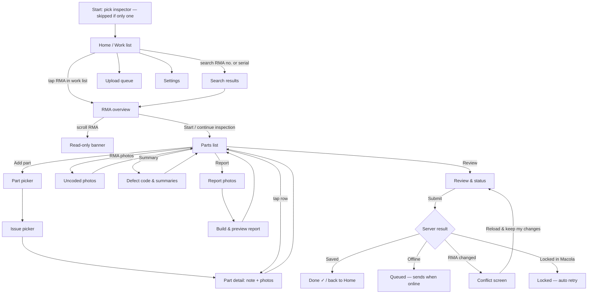

# RMA Inspection App — Functional Spec (v1 DRAFT)

_Draft 2026-11-17 (rev 6 — SAP-ready contract: opaque RMA/row ids, code objects with optional group, optional
cause code, summaries as blocks; see `docs/api.md` §1 and `docs/sap_mapping.md`. Rev 5 — round-5 answers: close/reopen RMA-team only, no device key, full change review,
30-day photo retention. Rev 4 — the app now covers the inspection **and** the report: report-photo selection and
report building. Earlier: no sign-in for now, any status, folder creation, summaries on tablet, failure
context read-only, numeric RMAs, no barcode in v1). Follows `RMA_Inspection_App_Dev_Plan.md` (v2.2) and `Inspection_Checklists_DRAFT.md` (v1 decisions).
Source-of-truth order: `RMA_DATA_MAP.md` > context pack 00–04 > Macola_SQL_Context. API details: `docs/api.md`._

> All RMA numbers, names and folder paths in this file are **fake examples**. No real RMA/customer data,
> server names, IPs or credentials belong in this repo.

---

## 1. Purpose and scope

A shop-floor Android tablet app covering the **whole inspection-to-report process**. The inspector looks up
an RMA, records parts examined (part code + issue code + note), takes photos, sets the inspection status,
writes the **General Defect Code and summaries** (the inspector is the summary author), picks and captions the
report photos, and builds the RMA report (PDF + XLSX). Everything goes through the
**RMA app server**, which reuses the RMA Tools workbench core modules (`rma_tools_core.py`,
`rma_flex_core.py`) to read/write Macola and file photos to the G: RMA folder.

The **workbench (desk) is a companion**, not a separate step: it edits the same fields with a keyboard and
gives room for research while writing summaries. Either side can finish an inspection or build the report.

| In v1 (tablet) | Not on the tablet (desk / workbench only) |
|---|---|
| RMA lookup (RMA no. or serial), header info read-only — incl. Failure Code, Failure Description, Comments and credit status as context | Editing Failure Code, Failure Description, Comments, credit status (RMA team fields: Failure Description comes from the customer's RMA request; credit status is the warranty decision by the sales manager and RMA team) |
| Parts grid: add / edit / reorder / remove any row (`oermactl_ipro_detail`) — full control, including desk-entered rows | |
| Photos per part (optional) and uncoded RMA photos → `All Pics` (folders created if missing) | |
| Report photos: pick any number from `All Pics`, caption, remove → `Report Pics ` | |
| Build report (`<RMA> Report.pdf` + `.xlsx`), preview PDF, spell check | |
| Inspection status: **any** status, like the Windows workbench | Close / reopen (Macola closure) — RMA team function, not in the app |
| General Defect Code, summary text blocks (Macola: 3 × 4000), `inspected_by`, `summary_by` (Macola: `oermahdr_extended_ipro`) | |
| Offline work + upload queue, conflict/lock messages | |

**Product types:** all non-scroll types are active. **Scroll** RMAs open read-only with a banner
("Scroll inspections are recorded in the Access repair DB"). The server decides this per product type, so
scroll can be switched on later without an app update (see §7).

**Not in v1:** curated per-family checklists, required parts, sub-families, prompts for photos/notes,
megger step, hidden codes (the server supports a hidden list, empty in v1), AI features.

---

## 2. Users and sign-in

- **v1: no sign-in.** One inspector profile is configured on the server (username for the audit `UserID`,
  display name, initials). The tablet shows who it is acting as on Home.
- The server keeps an **inspector list** (3 today, room for 10). With one entry the tablet skips any picker;
  with more than one, the tablet shows a "Who's inspecting?" pick list (no password) — the first step toward
  real sign-in.
- Audit `UserID` = the selected inspector's username + `_SQL` (never a service-account name).
- `inspected_by` and `summary_by` are **separate fields** (they can be different people). Each is pre-filled
  with the current inspector's initials only when it is empty, and is edited independently; the app never
  copies one into the other. (Today both are typed by hand.)
- **No device key or other API protection in v1** (decided 2026-11-17): the server is reachable only on
  BITZER's internal network. A device key or real sign-in can be added later without changing the screens.
- **Later:** real sign-in (AD/Entra/PIN — still to decide) slots in as `POST /auth/login` → token; the rest of
  the API doesn't change (`docs/api.md` §3). Queued work keeps the identity of the inspector who did it.

---

## 3. Screen flow



### 3.1 Start / inspector
- v1: no sign-in. If the server lists more than one inspector, show a "Who's inspecting?" pick list;
  otherwise go straight to Home. "Switch inspector" lives in Settings.
- Shows server reachability and app version. If the server reports the app is too old (`426`), show
  "Update required" with the release link.

### 3.2 Home / Work list
- **Search box**: free text — RMA number, serial, or (after SAP) whatever identifies an RMA there. The tablet
  only trims it; **the server decides what it matches** (no number format rule on the tablet). Typed by hand in
  v1; barcode/QR scanning is a possible later feature.
- RMAs are shown by their `display_number`; the tablet uses the opaque `rma_id` only to call the server.
- **Work list**: RMAs to tap instead of typing. **Status filter chips for every inspection status** — the
  inspector can show any of them. Default selection (server setting): **Received**, **Rework in Progress**,
  **Inspected**, **Report Complete** (Report Complete for rebuilds). The tablet remembers the last selection.
  From `GET /rmas`, newest
  first, with RMA, model, product type, status, lock badge. Pull to refresh.
- **On this tablet**: RMAs with local drafts or queued submissions (works offline).
- Badges: queue count, offline indicator, code-list age.

### 3.3 Search results
- One match → go straight to RMA overview. Several (serial search) → list with RMA, model, status, Macola
  open/closed. Closed or no-iPro-record RMAs are shown greyed out and cannot be inspected.

### 3.4 RMA overview (read-only header)
- RMA no., customer name, model, failed serial, sales order, product type, return code, inspection status,
  credit status (read-only), failed date, RMA comment (`rma_cmt`).
- **Failure context (read-only):** Failure Code, Failure Description and Comments as entered at the desk/CSR.
- Lock state ("Open in Macola by …" / "Possible stale lock") — informational; writes are re-checked at submit.
- Existing parts rows (from Macola), defect code, summary preview, inspected-by, and existing photo count in
  `All Pics`.
- Button: **Start inspection** (or **Continue** if a local draft exists). Downloading the RMA stores a local
  snapshot + its `signature` so work can continue offline.
- Scroll (or any type with `findings: false`): button hidden, banner shown.

### 3.5 Parts list (the inspection)
- Rows in the inspector's order: `NN  part code  part description  ·  issue code  issue description  ·  📷 n  ·  📝`.
  `NN` is the row's position on screen. Existing rows load first in the order the server sends them; each keeps
  its opaque `row_id` (the tablet never shows or computes line numbers).
- **Cause** (optional per row): the cause picker appears only when `/codelists` sends causes. Macola has none,
  so v1 shows no cause field and sends `cause_code: null`.
- Actions: **Add part**, tap row to edit, drag handle to reorder, swipe/delete to remove (with undo).
  Applies to every row, including rows entered at the desk (full control).
- Header strip shows defect code and summary state ("Summary: 2 of 3 filled") with a button to the Summary screen.
- The same part code may appear more than once (e.g. two cylinders).
- No required items, no prompts, no order enforced (v1 decisions).
- Draft is saved locally on every change (survives app kill / battery swap).

### 3.6 Part picker / Issue picker
- Full-screen searchable list over **all** codes from the cached code lists; search matches code or description.
- Codes are **code objects** (`group` + `code`, `group` null for Macola). **Natural sort** on group, then code
  (`48` < `48a` < `100`). Codes are text — never parsed as numbers. When a group is present the picker shows it
  as a section heading.
- The tablet **stores and sends back codes exactly as received** — never retyped, trimmed, padded or recased.
- Issue picker shows **`50` Normal first**, then the rest in natural order.
- "Recently used" strip at the top (local to the tablet) to speed up repeat entries.
- Codes in the server's hidden list (empty in v1) are not offered, but still display if already on an RMA.

### 3.7 Part detail
- Part and issue (tap to change), note (multi-line, max 4000 chars, counter shown), photos for this row.
- **Take photo** / **Retake** / delete. Thumbnails show the filename the photo will get (preview — the server
  makes the final name, §5).

### 3.8 Uncoded photos (RMA-level)
- Photos not tied to a part row: tag chosen from a short list — **As received**, **Nameplate**,
  **Overview**, **Packaging/Freight**, **Other** (free text, max 40 chars). None are required in v1.

### 3.9 Defect code & summaries
Writes the RMA's summary record (Macola: `oermahdr_extended_ipro`, one row per RMA; the server creates it if missing).
- **Failure context** at the top, read-only: Failure Code, Failure Description, Comments (collapsible).
- **General Defect Code**: searchable picker over `defect_codes` from `/codelists` (natural sort; e.g.
  `10` Lack of lubrication). Can be cleared.
- **Summary text blocks**: one large multi-line box per entry in `summary_blocks` from `/codelists`, labelled
  and limited as the server says (Macola: "Summary 1–3", 4000 characters each), with counters. Typed or
  dictated (Android keyboard voice input). The tablet has no fixed number of summaries.
- **Insert standard wording** button (first block, only when empty) inserts the standard template for the inspector
  to fill in: _"The primary failure mode is the [ ] of the [ ] likely due to [ ]. Failure progression resulted
  in [ ]. Common causes for [ ] include [ ]. No defects in materials or workmanship were found with this
  compressor."_ The template text is served by the server, so it can change without an app update.
- **Inspected by** and **Summary by**: separate fields, each pre-filled with the inspector's initials only if
  empty, edited independently (max 255).
- Nothing here is required in v1; the workbench can finish or edit any of it.
- No audit rows are written for these fields (Macola behaviour; SAP behaviour per `docs/sap_mapping.md`).

### 3.10 Review & status
- Summary: rows added / changed / removed vs. Macola, defect code / summary / initials changes, photo count,
  status change.
- **Status**: any of the 11 inspection statuses the workbench offers (Open … Closed; "No Charge Entered"
  excluded like Macola's screen), served by the server. "No change" is the default.
  Setting **Closed** here is the *inspection* status only — Macola closure stays a desk action.
- **Submit** sends the findings (parts grid + defect code/summaries + status) first, then the photos (§6).

### 3.11 Submit results
| Result | Tablet shows | What happens to the draft |
|---|---|---|
| Saved (`200`) | "Saved ✓" + photo upload progress | Draft cleared once photos finish; new signature stored |
| Offline / server unreachable | "Queued — will send when online" | Kept in queue, auto-retry with back-off |
| **RMA changed** (`409 RMA_CHANGED`) | Conflict screen (§3.12) | Kept; nothing written |
| **Locked in Macola** (`423 RMA_LOCKED`) | "Open in Macola by <name> since… — will retry" (or "Possible stale lock — ask IT") | Kept; auto-retry every few minutes; inspector can cancel |
| Lock check failed (`503 LOCK_CHECK_FAILED`) | "Can't confirm Macola lock — nothing saved, will retry" | Kept; auto-retry |
| Validation (`422`) | Field-level errors (unknown code, too long, bad transition) | Kept; inspector fixes |
| RMA closed / not inspectable (`409 RMA_NOT_OPEN`) | "RMA is closed — ask the RMA team" | Kept read-only; can export/discard |
| Product type not enabled (`403`) | Read-only banner | Kept read-only |

The tablet **never** silently overwrites and never retries a `409 RMA_CHANGED` on its own.

### 3.12 Conflict screen
- **Rule: any change made elsewhere while the inspection is in progress is reviewed, never overwritten.** The
  server's change check covers the **whole RMA record** it loaded — including fields the tablet can't edit
  (Comments, Failure Code/Description, credit status) — and `Report Pics `.
- Shows everything that changed on the server since the tablet downloaded the RMA (status, rows, defect code,
  summaries, initials, RMA-team fields) next to the local edits. Common case: summary typed at the desk while
  the tablet had a draft. Changes to RMA-team fields are shown for information ("Credit status changed to
  F - Full Warranty Credit at the desk") and need only an OK.
- No automatic merging, even when the two sides changed different fields — the inspector always reviews.
- Options:
  1. **Reload and keep my changes** — downloads the current RMA, re-applies the local edits on top
     (added rows appended; edited/removed rows matched by the original row values; a summary field changed on
     **both** sides is shown side by side and the inspector picks one or merges; anything ambiguous is
     flagged), then returns to Review.
  2. **Discard my changes** — reloads the RMA.
  3. **Send photos only** — files the photos without touching Macola.

### 3.13 Upload queue
- List of queued submissions and photos per RMA with state (waiting / sending / blocked: reason).
- Retry now, cancel (with confirmation), view error detail.

### 3.14 Settings
- Server URL (set once by IT), current inspector /
  switch inspector, code-list refresh (last updated time), photo quality info, app version,
  "send diagnostics log" (no RMA data in the log).

---

### 3.15 Report photos
Reached from the parts list ("Report") or the RMA overview. Needs a connection (works on server folders).
- Grid of all photos in `All Pics` (thumbnails from the server, so desk photos show too) with a tick for
  "in report". Photos already in `Report Pics ` (e.g. picked at the desk) show ticked.
- **Any number** of photos — the inspector decides. A counter shows how many are picked (~20 is typical;
  no limit, no warning).
- Tap a picked photo to open it full size and **edit its caption**. Caption = the filename of the copy in
  `Report Pics ` (sanitised like §5.2, unique, ≤ 120 chars). Starts as the `All Pics` name.
- **Order** = the caption order (natural sort of the names), shown live in a "report order" strip. Changing the
  number at the start of a caption moves the photo. (Drag-to-reorder may come later.)
- **Save selection** sends the full list; the server copies new picks, renames edited captions, and moves
  un-picked copies to a server backup folder. The original in `All Pics` is never renamed or deleted.
- If someone changed `Report Pics ` at the desk meanwhile → "Report photos were changed at the desk — reload?"

### 3.16 Build & preview report
- Pre-check shown before building: unsent findings (must submit first — button disabled), report photo count,
  empty summaries, no credit status yet (page 1 will say "Disposition Pending").
- **Spell check** button on the Summary screen and here: underlines words the server flags (same trade-word
  list as the workbench), with suggestions.
- **Build report** → server runs the workbench report code on current Macola data + `Report Pics `, backs up
  any existing report, writes `<RMA> Report.pdf` and `<RMA> Report.xlsx` into the RMA folder.
- Result shows page count, warnings, and opens the PDF in a viewer. Rebuild any time.
- "Report file is open on someone's PC" → message + retry.
- **Status is not changed automatically in v1** — the inspector sets Report Complete on the Review screen.
  Later: a server setting can set Report Complete automatically after a successful build.

---

## 4. Offline behaviour

- **Code lists** (parts, issues, defect codes, statuses, product types, inspector list, summary template,
  hidden list) are cached and refreshed on
  sign-in and every few hours when online (`ETag` → `304` when unchanged).
- **RMA snapshot** (header + parts rows + defect code/summaries + `signature`) is cached when opened. Lookup of a new RMA needs the server.
- All edits and photos are stored locally first. Submissions are idempotent (`submission_id`, `photo_id`), so
  a retry after a dropped connection never writes twice.
- Local storage is app-private; drafts and photos are deleted from the tablet after a successful upload
  (photos kept for **30 days** in a "sent" area as a safety net; server setting, review later for storage).

---

## 5. Photo naming convention

Photo **filename = report caption** (without extension) and the natural-sort order in `All Pics`
(RMA_DATA_MAP §9). The **server** builds the final filename from structured fields the tablet sends
(`docs/api.md` §8), using live code descriptions, so naming rules live in one place.

### 5.1 Pattern

```
Part photo:     <SS>-<n> <Part description> - <Issue code> <Issue description>.jpg
Uncoded photo:  00-<n> <Tag>.jpg
```

| Piece | Rule |
|---|---|
| `SS` | Row position in the inspection at upload time, 2 digits (`01`–`99`; 3 digits past 99). `00` = uncoded RMA photos, so they sort first. |
| `n` | Photo number for that row, 1, 2, 3… (no padding; natural sort orders `10` after `9`). Always present so every photo of a row sorts together. |
| Part description | From `oermactl_ipro_parts`, sanitised (§5.2), max 40 chars. Part code is **not** included (reads better as a caption). |
| Issue code + description | From `oermactl_ipro_issues`, sanitised, description max 30 chars. Code kept so "Normal" vs fault codes are visible. |
| Tag | As received / Nameplate / Overview / Packaging-Freight / free text (sanitised, max 40). |
| Extension | `.jpg` always (tablet compresses to JPEG). |

**Examples** (fake RMA 912345):

```
00-1 As received.jpg
00-2 Nameplate.jpg
01-1 Terminal box - 50 Normal.jpg
02-1 Winding resistance - 39 Winding fault.jpg
03-1 Piston assy, skirt - 34 Scored, Scratched.jpg
03-2 Piston assy, skirt - 34 Scored, Scratched.jpg
04-1 Connecting rod main bearing - 13 Heavy wear.jpg
```

> **Change vs. dev plan (approved 2026-11-17):** the plan's example was `03 Piston assy - 34 Scored.jpg`. The
> `-<n>` photo number is added because a bare name followed by `(2)` sorts **before** the bare name in natural
> sort, and a row can have several photos. Plan key fact 8 should be updated to this pattern.

### 5.2 Sanitising (Windows-safe, caption-friendly)
1. `w/` → `with`; then `/` → `, ` (e.g. `Piston assy / skirt` → `Piston assy, skirt`).
2. Remove `\ : * ? " < > |` and control characters (e.g. `Steel shaft ?` → `Steel shaft`).
3. Collapse repeated spaces/commas; trim spaces and trailing dots.
4. Keep everything else, including en dashes (`–`).
5. Whole filename ≤ 120 characters (truncate descriptions, never the `SS-n` prefix or code).

### 5.3 Collisions and later edits
- The server **never overwrites**. If a name is taken (or other photos already use that `SS-`), it uses the
  next free `n` for that `SS`.
- Re-uploads of the same `photo_id` return the original filename (idempotent).
- If rows are later reordered on the tablet or in the workbench, filenames already filed are **not** renamed
  (renaming is a desk action in the workbench viewer, if ever needed).

### 5.4 Image format
- JPEG, long edge **2048 px**, quality **85** (≈ 0.4–0.8 MB) by default. Both numbers are a **server setting**
  sent in the code lists, so they can change without an app update. Confirm during the pilot by building a
  real report from tablet photos.
- EXIF orientation applied to pixels; GPS and device EXIF stripped; capture time kept.
- Filed into `<root>\<3 digits>xxx\<4 digits>xx\<RMA>\All Pics` using the workbench's folder lookup
  (case/blank-tolerant). Report photos are **copies** in `Report Pics ` (§3.15), any number.

### 5.5 Folder creation (part of the workflow)
- If the lookup finds no folder, the server **creates** the missing levels: `<3>xxx`, `<4>xx`, `<RMA>`, and
  `All Pics` — only the levels that don't exist, using the bare RMA number.
- An existing folder that merely starts with the RMA number (suffix) is reused, never duplicated.
- `Report Pics `: when the first report photo is saved and no such folder exists, the server creates
  `Report Pics` *without* the trailing space (Windows can't make one with it). The workbench's folder lookup
  ignores blanks, so both the existing trailing-space folders and new ones are found.
- The response says whether a folder was created, and the server log records it.

---

## 6. Submit sequence

1. **Findings**: `POST /rmas/{rma_id}/inspection` with the full desired parts list (existing rows by `row_id`,
   new rows with `row_id: null`), optional status change, optional summary (defect code, changed summary blocks,
   `inspected_by`, `summary_by` — only changed parts), `base_signature` and `submission_id`. The response
   returns new `row_id`s, which replace the old ones on the tablet. Macola server runs the `apply_flex` path: validate → Macola lock check
   (fail closed) → re-read with UPDLOCK + signature compare → JSONL backup → status → summary row
   (UPDATE by `rec_id`, or INSERT with the raw padded `cus_no`) → parts → renumber `line_no` → commit → verify.
   A status change also writes one `OERMAAUD_iPro` row with the inspector's identity. Parts, defect code and
   summary edits write no audit row (matches Macola).
   The summary-row INSERT path is untested against production — include it in the Phase 4 read-only dry run
   and the first supervised writes.
2. **Photos**: `POST /rmas/{rma_id}/photos`, one per photo, after step 1 succeeds (so `SS` matches the saved row
   order). If step 1 is blocked, the inspector may choose **Send photos only** (names use the tablet's order).
3. The tablet shows final filenames returned by the server.

---

## 7. Product type handling (scroll-ready)

- Every RMA response carries `product_type` (raw backend value) and `product_type_key`
  (`recip`, `screw`, `scroll`, `part`, `transport`, `pressure_vessel`, `system_unit`, `unknown`).
- If `Product_Type` is blank, the server derives the key from the model prefix where it can
  (e.g. GSD/GTD/GUD/ELH/ELV/ELA/ESH → scroll; CS/HS/OS/CHS → screw) and sets `product_type_source: "model"`.
  If it still can't tell, the key is `unknown` with **full access**.
- Per-type **capabilities** come from server config: `{ findings, summary, photos, status, report }`.
  v1: all `true` for every non-scroll type, including `system_unit` and `unknown`; scroll all `false`.
  Phase 6 can turn on scroll photos/status first.
- The tablet only reads capabilities; it has no product-type rules of its own. Per-family checklists later will
  arrive the same way (as code-list data keyed by `product_type_key`).

---

## 8. Data rules the app must follow

- **Backend-neutral:** the tablet has no Macola- or SAP-specific rules. Everything backend-specific (padding,
  line numbers, lock tables, catalogs, audit users) lives in the server's backend connector.
- **RMA identity:** opaque `rma_id` + `display_number`; the tablet never parses, pads or validates them.
- **Rows:** opaque `row_id`, echoed back unchanged; new rows have `row_id: null`.
- **Codes:** code objects (`group`, `code`); preserve exact strings (`48a`, `104bb`, `15A`, `99 – JSIOC`) and
  send them back exactly as received. Natural sort for display. Only codes from `/codelists` can be picked.
- **Limits** come from the server (`/codelists` `limits`, per-block `max_length`). The tablet checks; the server
  re-checks.
- Notes with line breaks are sent with `\n`; the server converts for the backend.
- The tablet never talks to the ERP backend or the photo store directly and never sees server names, SQL or file
  paths beyond the relative photo folder.

---

## 9. Decisions (Jacob, 2026-11-17)

1. **Sign-in:** none in v1 — single inspector profile. Design for a pick list / real sign-in later
   (3 inspectors now, up to 10).
2. **Status:** the tablet can set **any** inspection status, like the Windows workbench.
3. **Photo naming:** `SS-n` pattern in §5 approved.
4. **Folders:** creating missing RMA / `All Pics` folders is part of the workflow (§5.5).
5. **Blank / unknown product type:** full access (also `System/Unit`).
6. **Existing Macola rows:** full control on the tablet.
7. **Defect code, summaries 1–3, `inspected_by`, `summary_by` are on the tablet.** The inspector writes the
   summaries; the workbench is a companion for typing and research. Initials pre-filled, editable.
8. **`summary_by` is independent of `inspected_by`** (not copied).
9. **Failure Code, Failure Description, Comments:** shown read-only on the tablet as failure context; edited
   at the desk.
10. ~~RMA numbers are digits only~~ — superseded by #23: the tablet treats RMAs as opaque; the server validates.
11. **No barcode/QR in v1** — manual RMA entry. Maybe later.
12. **Image size:** start at 2048 px / q85 as a server setting; confirm in the pilot.
13. **The app covers the inspection and the report.** Report-photo selection (copy from `All Pics` into
    `Report Pics `, captions editable) and report building (workbench report code, PDF + XLSX) are on the tablet.
14. **Report photo count is up to the inspector** — ~20 typical, no limit. The old 20-picture cap came from the
    Excel tool; lift it in the shared report module.
15. **Status after building a report stays manual for now.** Later: automate Report Complete after a
    successful build (server setting).
16. **Credit status, Failure Code, Failure Description, Comments stay RMA-team fields** — read-only in the app.
17. **Close / reopen are RMA-team functions** — not in the app.
18. **Report photo order** follows caption names; reorder options maybe later.
19. **Work list:** filter chips for any inspection status; default Received, Rework in Progress, Inspected,
    Report Complete.
20. **No device key / API protection in v1**; maybe later with sign-in.
21. **Changes made elsewhere during an inspection are always reviewed, never overwritten** — change check
    covers the whole RMA record and `Report Pics `; no auto-merge.
22. **Sent photos stay on the tablet 30 days**; evaluate storage later.
23. **SAP-ready contract (2026-11-17):** opaque `rma_id` + `display_number` (no number rule on the tablet);
    opaque server-assigned `row_id` per parts row; code objects with optional `group` (null for Macola), sent back
    exactly as given; optional `cause_code` per row (null, unused in v1); backend-neutral names (`is_open`,
    `inspectable`, `backend_reachable`, `BACKEND_UNAVAILABLE`); summaries as an ordered list of text blocks with
    per-block limits from `/codelists`. Sign-in path stays reserved; SAP will need per-inspector identity.

## 10. Open questions

None blocking. Items deferred to later phases: sign-in (up to 10 inspectors), device key, barcode/QR lookup,
drag-to-reorder report photos, automatic Report Complete, curated per-family checklists, scroll activation.
To verify in Phase 4: that the workbench's change-check signature covers every field the rule in §3.12 needs.
